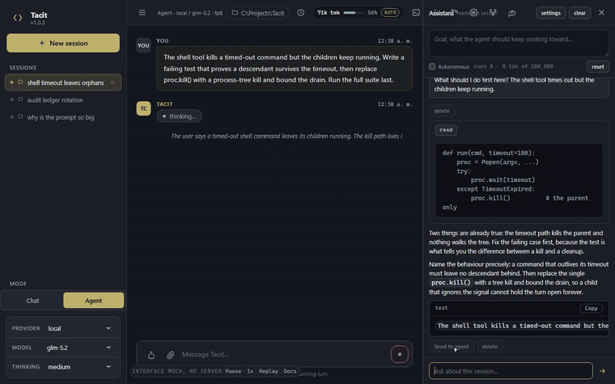

# Tacit

**The coding agent where nothing is hidden and nothing moves without you.**

Tacit is a coding agent you run yourself and use in your browser. It reads your files, runs commands,
edits code, searches the web, and connects to external tools. Requests go to a model provider you
configure; everything else stays on your machine. No accounts, no telemetry, no service to install.

The application is one Python program serving plain web pages: no build step, no frontend toolchain, no
database. That is a position rather than an accident. A coding harness is the part of the stack you are
supposed to be able to read, and a platform inside it is the part you cannot.

One turn costs a fixed amount before your question is read: 974 characters of standing instructions plus
every tool description the session is offered. The pair to remember is
768 tokens on Minimal and 2,039 on Default, and a test re-derives both from the code on every run.



If you want to see the demo: [demo.html](https://sebsilent.github.io/Tacit/demo.html).

---

## Quick start

**macOS, Linux, WSL**

```sh
curl -fsSL https://raw.githubusercontent.com/SebSilent/Tacit/HEAD/install.sh | bash
```

**Windows (PowerShell)**

```powershell
irm https://raw.githubusercontent.com/SebSilent/Tacit/HEAD/install.ps1 | iex
```

**Windows (cmd)**

```bat
powershell -NoProfile -c "irm https://raw.githubusercontent.com/SebSilent/Tacit/HEAD/install.ps1 | iex"
```

The installer fetches the source, makes a private virtual environment inside the checkout, and writes a
`tacit` launcher at `~/.local/bin/tacit` or `%LOCALAPPDATA%\Tacit\bin\tacit.cmd`. Re-running it updates
the checkout; `--no-browser` skips the optional 130 MB browser-automation step.

**Prerequisites: Python 3.10 or newer.** That is the only real one. `git` is used to update an existing
checkout if you have it, otherwise a source archive is fetched, and Node 22 is for the `browser` tool
only. No database, no build pipeline, and no other agent harness is required, referenced or contacted at
any stage.

```sh
tacit          # or ./run.sh, or run.bat
```

Open **http://localhost:8550**. The first start creates an empty `~/.tacit`. Add a provider in
**Settings > Providers** and your keys go to `~/.tacit/.env`. From a clone instead:

```sh
python -m venv .venv
.venv/bin/python -m pip install -r requirements.txt   # Windows: .venv\Scripts\python.exe
./run.sh                                              # or run.bat
```

Both launchers start on `.venv` and refuse to start without it, printing the two commands above rather
than using whatever `python` is first on your PATH. Full instructions, including relocating and removing
an install: [docs/install.md](docs/install.md).

---

## The interface, briefly

```
+--------------+---------------------------------+------------------+
|  Sessions    |  Workspace · Mode · Model       |   Assistant      |
|              +---------------------------------+  (goal · run)    |
|              |  transcript · tool cards        |                  |
|              +---------------------------------+                  |
|              |  composer            [Send]     |                  |
+--------------+---------------------------------+------------------+
```

Two conversations rather than one. The main agent works in your project and its tool cards carry the real
output. The **Assistant** on the right reads that session and helps with the work around the work: drafting
a prompt, questioning an approach, explaining what just happened. The main agent never sees it and is not
told an Assistant exists, and the Assistant's goal never becomes the agent's task. Its read access is a set
of switches with the token price shown before anything is sent, and its counter sits above its thread, so a
second conversation is never a hidden second bill.

The capture above is the interface running a scripted turn, live in your browser: look at it before you
install anything, and do not treat it as evidence of anything.
[docs/interface.md](docs/interface.md) covers the regions, snapshots and restart;
[docs/settings.md](docs/settings.md) says which tab owns which switch and which file it writes.

---

## What makes Tacit different

**The fixed cost of a turn is measured, shown, and yours to set.** Every request carries the standing
instructions plus every tool description, and most harnesses never say what that costs. Tacit quotes it in
the top bar per turn and in **Settings > General** per profile, computed from the live configuration rather
than from a table somebody typed: the six built-in profiles span ~768 to ~2,264 tokens. 2,039 tokens of
preamble on an 8K model is a quarter of the window before the work starts, and the way out is a switch
rather than a fork.

**Capabilities load when they are used, not when they are installed.** Skills and knowledge are listed by
name and fetched only when the agent asks (`backend/skills.py:50`). An MCP server's tool descriptions stay
out of the prompt: the agent gets four helpers to search, activate and call, and with no server configured
even those schemas are withdrawn (`backend/agent.py:850-852`). Your project's instruction files are indexed
by name and size instead of inlined, at 110 characters plus 40 per entry
(`backend/project_context.py:191-194`). A server with fifty tools costs nothing until one is used, so the
prompt grows with what you exercise rather than with what you installed.

**Long sessions are managed against a reserve, not a percentage.** Compaction fires at the model's window
minus about 33,000 tokens, because the room the next turn needs is roughly constant. A fraction is wrong at
both ends and this program had the wrong one: it compacted a 1M-token model at 650,000, discarding 350,000
tokens of usable context, and an 8K model at 5,200, leaving too little to answer in
(`backend/config.py:108`). The tail is kept by token budget, a pre-pass clears bulky tool output before the
summariser sees it, a failed summary still leaves a deterministic digest, compaction runs mid-turn as well
as between turns, and the standing prompt and the task are pinned against elision.
[docs/cost-and-profiles.md](docs/cost-and-profiles.md) has each mechanic with the line that implements it,
the row-by-row comparison against Claude Code, Hermes, little-coder and DSH, where each idea came from,
and the three places Tacit is still behind.

**A turn is a process, so stop means stop.** A thread cannot be killed in Python, and a turn is a unit of
work a person must be able to kill: blocked in a model read, stuck on a shell command, looping on a regex.
Each turn runs in its own worker subprocess (`backend/turn_worker.py:11-21`) and stop is two-stage: a
cooperative cancel first, which closes the model stream, kills the turn's shell trees and preserves the
partial transcript, then a process-tree kill after the grace period. Sessions do not leak into each other:
turn state is keyed by session id, a second prompt for a busy session is refused from any window, abort
cannot cross a session boundary, one WebSocket per session keeps a turn streaming while you look
elsewhere, and a viewer that arrives mid-turn is replayed from the event buffer.
[docs/architecture.md](docs/architecture.md).

**Nothing optional is on, and nothing learns without you.** The capability defaults live in one dict,
`backend/providers.py:22-38`: sandbox `none`, memory `off`, learning `learn-off`. Memory's budget is
enforced on the rendered block rather than on the sum of the entries, so the header and separators are
counted and the block cannot silently expand (`backend/memory_modes.py:120-126`), and retrieval is keyword
based with no embeddings. Learning proposes and does not act: the analyzer pattern-matches finished turns
on a thread that does not start while the mode is `learn-off`, registers no tool and adds no prompt text,
and its model pass is a second switch that is off (`backend/proposal_pass.py:52`). A proposal carries the
session, the turn and the exact sentence that triggered it, and approving one writes to memory under the
memory budget or to a skill file, so an approved rule goes back through the same budgets as everything
else. [docs/memory-and-learning.md](docs/memory-and-learning.md).

---

## What a turn costs, against the alternatives

Measured on one machine with one rule: characters divided by four, the fallback heuristic Tacit uses when
no exact tokenizer is installed and the one DSH documents for its own token meter, so nothing is measured by
a standard it does not already apply to itself. Every figure counts what the harness sends, not what a bill
looks like.

| System | System prompt | Tools | Tool schemas | Fixed cost per turn |
|---|---|---|---|---|
| **Tacit, Minimal** | **974 chars** | **7** | **2.0 KB** | **~768 tokens** |
| Pi | 1,352 chars | 7 | 4.5 KB | ~1,600 |
| **Tacit, default profile** | **974 chars** | **21** | **7.0 KB** | **~2,039** |
| little-coder | 7,747 chars | ~29 | 10.4 KB | ~4,600 |
| DSH | 6,195 chars | 25 | 26.7 KB | ~8,390 |
| Hermes Agent | 23,370 chars | 32 | 51.3 KB | ~18,970 |

Tacit appears twice because the profile is the variable, and the two rows are the same program:
768 tokens on Minimal and 2,039 on Default. The other rows were read out of the installed programs on this
machine and are reproducible from their own tooling; Tacit's are read from its own profile selector and
derived from `profiles.cost_of` by a test on every run. The first row is the one worth arguing about,
because it compares the same seven capabilities on both sides: the Minimal profile ships exactly what Pi
ships, which is read, write, edit, shell, grep, list and glob.

| Same seven capabilities | Tacit | Pi |
|---|---|---|
| Tool schemas | **2,001 chars** | 4,626 chars |
| System prompt | **974 chars** | 1,352 chars |
| **Fixed cost per turn** | **~768 tokens** | **~1,600** |

Two things account for the gap: Pi's descriptions are longer (its `read` takes the same three parameters and
costs 182 tokens against 67), and the standing prompt is smaller to begin with. Pi's `grep` exposes more
options than Tacit's, so that one cell is not a fair fight.

**What this does not prove.** A smaller fixed cost is not a lower API bill and not a higher solve rate. It
is one term in a sum: total spend is the preamble times the number of steps plus the transcript, and a
harness that sends less per step but takes more steps can lose. It is also the term a person can control,
which is why it is measured and published rather than asserted.

### The six built-in profiles

| Profile | Tools | Sandbox | Memory | Learning | Fixed cost |
|---|---|---|---|---|---|
| **minimal** | 7 | none | off | off | ~768 tokens |
| **default** | 21 | none | off | off | ~2,039 tokens |
| **safe** | 22 | tacit-micro | explicit | off | `default` + the memory tools + budget |
| **power-isolation** | 22 | tacit-micro | explicit | off | `default` + the memory tools + budget |
| **power-memory** | 23 | none | full, budgeted | off | `default` + the memory tools + budget |
| **full** | 23 | tacit-micro | full, budgeted | off | `default` + the memory tools + budget |

The tool count moves with the memory mode, because memory is a capability the profile selects rather than a
plugin it enables: `explicit` is offered the propose tool only, `jit` and `full` also get the search tool.
No profile turns learning on, not even proposing: a profile sets cost and containment, and does not decide
what Tacit is allowed to remember on its own. **minimal** is the one for a small model or a tight window,
and what you give up is browsing, sub-agents, plan mode, research and snapshots. You can save the current
configuration under your own name. The presets matter less than the habit: the cost of a configuration
should be knowable before you adopt it, not discovered later in a bill or a truncated conversation.

### Caching, because a long session is the whole bill

An agent loop re-sends its transcript on every step, and providers do not agree on how caching works, so
Tacit uses the strategy the endpoint actually supports.

| Endpoint | Strategy | What is sent |
|---|---|---|
| Anthropic (`api.anthropic.com`) | native Messages API | breakpoints on tools, system and the last message |
| OpenRouter | OpenAI shape, passthrough | one breakpoint on the system block |
| Any other OpenAI-compatible server | provider-side automatic | **nothing added** |

The last row matters most: prefix caching needs no markers there, and a server that has never seen
`cache_control` may reject the body outright. Around the rest (`backend/config.py:995-1000`): a rejection is
retried once without the markers, detected before any event streams, so nothing is half-sent and repeated;
`TACIT_PROMPT_CACHE=off` turns marking off; and what is in force is reported with the hit rate observed.
One measured run on an OpenAI-compatible endpoint reported **71.1%** of prompt tokens served from cache.

---

## Evidence: OpenBench

One model for every row: GLM 5.2 on the fp8 endpoint, run by OpenBench's own runner with its `checker.sh`
files untouched. Three tasks, three trials each, one build, both operating systems. Tokens are uncached
input plus output, cache reads excluded, counted the way OpenBench counts them. All rows are Tacit v1.0.0.

**Linux**

| Profile | Solved | Tokens per solve | Wall seconds per cell |
|---|---|---|---|
| Default | 9/9 | 156,466 | 705 |
| Minimal | 9/9 | 133,881 | 648 |

**Windows**

| Profile | Solved | Tokens per solve | Wall seconds per cell |
|---|---|---|---|
| Default | 6/6 | 106,526 | 530 |
| Minimal | 5/6 | 82,814 | 418 |

Schemelike is graded on Linux only so far: its checker reads `os.O_NONBLOCK`, which Windows Python does not
provide.

**Against the published arms, same model, same three tasks**

| Arm | Solved | Cells that errored |
|---|---|---|
| Tacit, Linux, default | 9/9 | 0 |
| Tacit, Linux, minimal | 9/9 | 0 |
| Pi | 8/9 | 3 |
| OpenCode | 7/9 | 3 |
| Claude | 5/9 | 5 |
| Grok | 5/9 | 6 |
| Codex | 4/9 | 5 |

An errored cell is a run where the arm's own plumbing decided the outcome, and its tokens still got spent.
That column is what a token table cannot show.

**Read the scope with the result.** These rows come from one model, one endpoint, one machine, twenty cells
of it. Three trials per task is enough to show a plumbing failure and not enough to rank harnesses on a
hard task. Tacit solved 9/9 on Linux where the published arms managed 8/9 or fewer, which says these three
tasks, on this model, did not break this loop. It does not generalize, and the Windows Minimal row at 5/6
is the counterexample already in the table.

**Three harness behaviours changed these scores, and they are here so you can discount them.** The delivery
guarantee, on by default, finishes a write the turn started and missed when it is about to end with nothing
on disk, gives the salvage phase three rounds rather than one, and spends the last minutes of wall budget
landing it (`backend/config.py:456-464`, `backend/agent.py:806-809`): on, a failed cell is still a
graded artifact, and `TACIT_DELIVER_GUARANTEE=0` is the raw mode where the turn ends when the agent ends it.
The repeat guard answers an identical call from cache after three runs and ends a turn after four blocked
repeats (`backend/agent.py:797-806`), because one cell spent 26 of its 29 shell calls on refused repeats
and ended with nothing written. The uncapped retry re-asks a round this harness's own output ceiling
destroyed, so thinking is never billed as waste, and that one is not part of the delivery switch.

**Run it yourself; that is the point of publishing it.** A three-trial run of one task lands before your
coffee is cold. The cells this table wants next: any first-party or fp8 route for kimi and qwen, DeepSeek
and Qwen as the model, an Apple silicon lane, a rerun of ours on whatever you have, and a Windows port of
the schemelike checker. Tuning is wanted too, since the other arms ship tuned for the models they run and
Tacit's profiles and prefs are the tuning surface. Send your rows back through a pull request or an issue
with the jsonl attached and your arm gets a line in the table with your name on it.

Methodology, the per-task breakdown, and how each row is audited:
[docs/testing-and-benchmarks.md](docs/testing-and-benchmarks.md).

---

## Security, privacy and control

**It reports what it enforces.** A command either runs under the backend you chose or it does not run;
nothing is silently downgraded (`backend/sandbox.py:9-10`). Anything the platform cannot enforce is reported
as not enforced: on Windows the base OS has no isolation primitive, so the result says plainly that
filesystem and network isolation are not in force, and the timeout and the change report are what you
actually get. `tacit-micro` uses the strongest primitive the OS does offer, bubblewrap on Linux and
`sandbox-exec` on macOS. The `container` backend, opt-in and available wherever Docker or Podman runs,
Windows included over WSL2, adds a network namespace, a read-only or read-write project bind, private
`/tmp`, memory and CPU ceilings, a PID limit and privilege escalation off. It was checked by hand against
Docker Engine 29.8.1 over WSL2, and [docs/isolation-and-audit.md](docs/isolation-and-audit.md) lists what
came back: a refused connection under `--network none`, a read-only bind rejected by the kernel, a write
from inside landing on the host and in the change report, `NoNewPrivs` at 1, and no surviving container
after a timeout. `test_isolation.py` covers the logic against a stubbed runtime on every commit; no
live-daemon test is shipped, so those hand checks are not re-run.

**The timeout is enforced, not merely reported.** `TACIT_SHELL_TIMEOUT` names the seconds a command may
run, and on Windows it used to be a lie: killing a `cmd /c` or `.bat` wrapper left grandchildren alive
holding the captured pipe. The whole tree is killed and the drain is bounded, so a timeout returns in about
the time it names.

**Every decision is in a file you can read.** Each tool call, sandbox decision, memory injection, learning
proposal and approval is appended to `~/.tacit/audit.jsonl`: plain JSONL, credentials masked at any depth,
including a token in a URL's query string. Nothing is edited or removed: the *clear* action retires the file
under a timestamped name and records the rotation as the first entry of the new one. All state lives under
that folder and deleting it removes all of it, file by file in
[docs/data-and-privacy.md](docs/data-and-privacy.md).

**Undo is a person's instrument.** A snapshot is taken once per turn, before the first change, whether it
arrives through `write_file`, `edit_file` or a shell command, and a failed snapshot is reported without
blocking the edit. The agent is not offered `snapshot`, `list_snapshots` or `restore`: a model that can
restore its own work can hide what it just did.

**Off unless you say otherwise:** version control for the agent, plugins, external tool servers, memory,
sandboxing, learning, and the per-turn token ceiling. New MCP servers are added disabled and never started
automatically, per-server allow and deny lists decide what may run, and tools that look destructive ask
first. A plugin's code loads only after you enable it, and its token cost is measured from the schemas it
contributes and shown beforehand. Tacit installs nothing on its own: where a feature needs something
outside the standard library the interface names the package, why, how large, and the command that would
install it, and until you run it the feature reports itself unavailable instead of half working.

**On the network.** No telemetry, no analytics, no tracking anywhere in the codebase. The outbound calls are
the provider you configured, the optional update check, the GitHub panel you use, the `fetch` and `browser`
tools when the agent asks, and MCP servers you added. `TACIT_HOST` is yours: `127.0.0.1` keeps it local,
the `0.0.0.0` default puts it on your network, and there is no login system, so bring your own. The updater
compares `VERSION` over HTTP and unpacks a branch tarball over the checkout, leaves a git checkout alone,
never touches your state, and reports a file upstream no longer has instead of deleting it, because an
archive cannot tell "they removed this" from "you added this".

---

## Documentation

The README states what Tacit is and what it costs. `docs/` states how it works, where each setting lives,
and which line of code decides it. Every citation there is a file and a line you can open, and a test
opens all of them. Start at [docs/index.md](docs/index.md).

| Page | What it answers |
|---|---|
| [Install](docs/install.md) | getting it running, and what the installers do |
| [Interface](docs/interface.md) | the three regions, snapshots, restart, sounds |
| [Settings](docs/settings.md) | which tab owns which switch and which file it writes |
| [Configuration](docs/configuration.md) | every environment variable, every preference key, and which one wins |
| [Tools](docs/tools.md) | the 22 tools in the registry, and the four rules that decide how many a session is offered |
| [Architecture](docs/architecture.md) | server, session runtime, turn worker, routers, the agent loop |
| [Cost and profiles](docs/cost-and-profiles.md) | how a token figure is produced, what each profile changes, and how a long session is managed against the alternatives |
| [Isolation and audit](docs/isolation-and-audit.md) | what a command was allowed to touch, what it changed, and the container results |
| [Memory and learning](docs/memory-and-learning.md) | the four memory modes, the budget, and how a proposal becomes a rule |
| [MCP and plugins](docs/mcp-and-plugins.md) | external tools without the prompt cost |
| [Data and privacy](docs/data-and-privacy.md) | every file Tacit writes and what is in it |
| [Testing and benchmarks](docs/testing-and-benchmarks.md) | how to run the suite and what the published figures came from |

[docs/configuration.md](docs/configuration.md) is where you look up a knob. Every `TACIT_*` name in this
README is read from the environment by name in `backend/config.py`, and a name that is not in that table is
not a setting. Where a variable duplicates something **Settings** can set, the environment wins and the
interface says so.

---

## Contributing and testing

```sh
python -m unittest discover -s tests -t .
python scripts/check_prose.py
```

The suite runs offline: no network, no real model, no container daemon, no benchmark runner, and Tacit
installs neither. The count is whatever the suite reports, not a number maintained by hand. The files that
guard the architecture rather than a feature are `test_turn_worker.py`, `test_session_isolation.py`,
`test_isolation.py`, `test_engine.py`, `test_docs.py`, `test_frontend_weight.py`, and `test_claims.py`,
which enforces each behaviour this README claims, including the agent loop end to end.

Two rules are executable rather than editorial. **The documentation is a specification:**
`tests/test_docs.py` checks that every `TACIT_*` name in a doc is read by code, that every `path:line`
citation points at a real non-blank line inside a real file, that relative links resolve, and that every
page in `docs/` is reachable from the index. **The prose has a denylist:** `scripts/check_prose.py` fails on
em dashes, hollow adjectives and throat-clearing openers. If you cannot point at the line you do not know
the answer, and you do not write the sentence: that is why the figures here carry a method instead of an
adjective. [CONTRIBUTING.md](CONTRIBUTING.md) covers the layout and the house rules.

---

## Status and known limits

Working and covered by tests: agent turns against any OpenAI-compatible endpoint, sub-agents, plan mode,
skills, compaction, background processes, snapshots with restore, the terminal, providers, sessions, token
accounting and the dashboard, capability profiles, session isolation, the killable turn worker, MCP over
stdio and HTTP with lazy activation, plugins, isolation, budgeted memory, approval-first learning, one-time
migration from an export you point at, the self-update transport, and the per-session Assistant.

What is not finished:

- **Windows has no isolation primitive.** `mechanism: none` is the answer there, and the timeout plus the
  change report are all that is enforced.
- **Token counts are estimates without `tiktoken`.** Every figure here is marked `~` when it is one, and no
  number for another product is estimated at all.
- **The default shell timeout is 180 seconds**, so a genuinely slow command owns those three minutes. Lower
  `TACIT_SHELL_TIMEOUT` to fail faster.
- **Container isolation needs a runtime you install yourself**, and was checked by hand rather than by a
  shipped test. A machine without one gets a report that the backend is unavailable rather than a quiet
  fallback to `none`.
- **Retrieval is keyword-only**, and **the task strip is read-only**: the model owns the list, and letting a
  person reorder it is still missing.
- **Anthropic cache breakpoints cover the stable prefix and the last message only.**
- **There are no releases.** The default branch is the product, which is why the updater exists.

---

## License

MIT. See [LICENSE](LICENSE).
